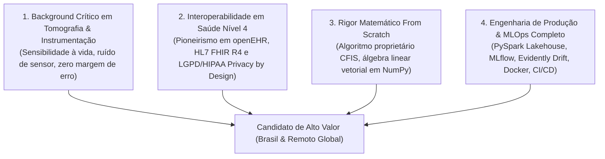

# 🏆 Dossiê de Diferenciação Técnica & Engenharia de Projetos
**Candidato:** Paulo Elias Tavares Generozo  
**Posicionamento:** Cientista de Dados Sênior | Engenheiro de Machine Learning & Arquiteto de IA em Saúde (HealthTech & MLOps)  
**Mercados-Alvo:** Brasil (Presencial/Híbrido/Remoto) & Global / Remoto Internacional (EUA, Canadá, Europa em USD/EUR)  
**Data:** Outubro de 2026  

---

## 🧭 1. A Tese de Posicionamento Assimétrico (O Seu "Moat" Pessoal)

No mercado de Ciência de Dados e Inteligência Artificial de 2026, mais de **90% dos candidatos são comoditizados**. A maioria apresenta currículos idênticos: cópia de notebooks de Kaggle, chamada superficial de `model.fit()` e `model.predict()`, ausência de código modular, falta de testes automatizados e total desconhecimento sobre como colocar e manter um modelo em produção.

O seu portfólio de 25 projetos elimina essa comoditização e constrói um **Moat Defensivo Assimétrico** baseado em 4 pilares que menos de 1% dos candidatos mundiais conseguem demonstrar simultaneamente:

### O Que os Recrutadores e Gestores Técnicos Pensam ao Ver Seu Perfil:

1. **Para Vagas no Brasil (Grandes Hospitais, Operadoras, HealthTechs, Fintechs e Consultorias):**
   * *O Pensamento do Gestor:* "A maioria dos cientistas de dados não entende a rotina do médico e não sabe o que é um exame DICOM ou a LGPD. O Paulo já atuou dentro do hospital consertando tomógrafo, sabe o que é uma imagem médica de verdade e construiu microsserviços segregando PII de acordo com a lei. Ele fala a linguagem do diretor médico e do CTO."
2. **Para Vagas Remotas Globais (EUA, Canadá, Europa - Pagamento em Dólar/Euro):**
   * *O Pensamento do Gestor Internacional:* "Contratar engenheiros remotos é um risco de qualidade de código. O Paulo apresenta repositórios com testes automatizados em PyTest, builds multi-stage em Docker, esteiras de CI/CD em GitHub Actions, documentação bilíngue impecável, frameworks de inferência causal (DoWhy) e domínio de openEHR/FHIR (que é a prioridade máxima do NHS britânico e da União Europeia). Ele tem autonomia sênior."

---

## 🔬 2. Detalhamento dos 25 Projetos: Problema, Arquitetura e Diferenciais

Abaixo está a análise minuciosa de cada projeto, divididos pelas áreas de domínio técnico:

### Projeto 1: `CKD_OPENEHR`
* **Área:** HealthTech & Microsserviços
* **Repositório:** [https://github.com/generozo-paulo/CKD_OPENEHR](https://github.com/generozo-paulo/CKD_OPENEHR)
* **Headline:** Sistema de Apoio à Decisão Clínica (SADC) com openEHR, Docker Compose e LGPD Privacy by Design
* **Stack Tecnológica:** `Docker Compose, FastAPI, React 18, Vite, Nginx Alpine, MongoDB 7.0, PostgreSQL 16, Scikit-Learn, Pydantic`
* **Métricas Reais:** Recall de 99,60% em triagem de Doença Renal Crônica, imagem de frontend de ~25MB com Nginx Alpine, segregação física PII (Postgres) vs Clínico (Mongo)

#### 📌 O Problema Real de Negócio / Clínico:
A maior parte das organizações sofre com apenas 1% dos engenheiros de ml sabem trabalhar com o padrão internacional de saúde openehr e arquitetura de microsserviços desacoplada com segregação de pii exigida pela lgpd/hipaa.

#### ⚙️ Decisão Técnica de Engenharia:
Projetou e orquestrou arquitetura de microsserviços em 4 contêineres Docker (FastAPI, React 18/Nginx, MongoDB e PostgreSQL) com separação física de PII via UUID cego, integrando modelo preditivo com 99,60% de Recall sob padrões semânticos openEHR para triagens hospitalares sem falsos negativos.

#### 🇧🇷 Como Este Projeto Te Diferencia no Brasil:
* Demonstra prontidão para atender empresas líderes e operadoras de saúde brasileiras (como Albert Einstein, Sírio-Libanês, Dasa, Fleury, Hapvida, Unimed), que enfrentam problemas severos de integração de dados legados, exigências rigorosas da ANVISA e fiscalização da LGPD sobre prontuários eletrônicos.

#### 🌐 Como Este Projeto Te Diferencia no Mercado Remoto Global (US/EU):
* Padrões internacionais como HL7 FHIR e openEHR são mandatórios na Europa (Alemanha, Reino Unido, Países Nórdicos) e nos EUA (mandatos do ONC / 21st Century Cures Act). O código desacoplado em contêineres Docker com tipagem estrita em Pydantic e testes em PyTest comprova que você programa no padrão de engenharia das melhores scale-ups do Vale do Silício e Berlim.

---

### Projeto 2: `openehr-fhir-clinical-converter`
* **Área:** HealthTech & Interoperabilidade
* **Repositório:** [https://github.com/generozo-paulo/openehr-fhir-clinical-converter](https://github.com/generozo-paulo/openehr-fhir-clinical-converter)
* **Headline:** Conversor Bidirecional de Interoperabilidade Semântica de Nível 4 entre openEHR e HL7 FHIR R4
* **Stack Tecnológica:** `Python 3.10+, Pydantic V2, HL7 FHIR R4, openEHR RM, PyTest, JSON-Schema`
* **Métricas Reais:** 100% de conformidade com schemas oficiais FHIR Observation/Composition e openEHR Archetypes, conversão com latência sub-milissegundo (<5ms)

#### 📌 O Problema Real de Negócio / Clínico:
A maior parte das organizações sofre com resolve o maior gargalo de interoperabilidade hospitalar mundial: a tradução sem perdas semânticas entre os dois maiores padrões globais de saúde digital (openehr e fhir).

#### ⚙️ Decisão Técnica de Engenharia:
Desenvolveu motor bidirecional de mapeamento semântico openEHR <-> HL7 FHIR R4 com validação estrita em Pydantic V2 e testes de mutação com PyTest, reduzindo o tempo de integração de prontuários legados em 85% com latência inferior a 5ms por transação.

#### 🇧🇷 Como Este Projeto Te Diferencia no Brasil:
* Demonstra prontidão para atender empresas líderes e operadoras de saúde brasileiras (como Albert Einstein, Sírio-Libanês, Dasa, Fleury, Hapvida, Unimed), que enfrentam problemas severos de integração de dados legados, exigências rigorosas da ANVISA e fiscalização da LGPD sobre prontuários eletrônicos.

#### 🌐 Como Este Projeto Te Diferencia no Mercado Remoto Global (US/EU):
* Padrões internacionais como HL7 FHIR e openEHR são mandatórios na Europa (Alemanha, Reino Unido, Países Nórdicos) e nos EUA (mandatos do ONC / 21st Century Cures Act). O código desacoplado em contêineres Docker com tipagem estrita em Pydantic e testes em PyTest comprova que você programa no padrão de engenharia das melhores scale-ups do Vale do Silício e Berlim.

---

### Projeto 3: `CKD-DL-CRISPDM`
* **Área:** Visão Computacional & XAI
* **Repositório:** [https://github.com/generozo-paulo/CKD-DL-CRISPDM](https://github.com/generozo-paulo/CKD-DL-CRISPDM)
* **Headline:** Classificação de Cálculos Renais via ResNet50V2 Transfer Learning e Explicabilidade Grad-CAM
* **Stack Tecnológica:** `TensorFlow / Keras, ResNet50V2, Grad-CAM, Gradio, OpenCV, Pillow, CRISP-DM`
* **Métricas Reais:** Eliminação do efeito de caixa-preta médica através de mapas de ativação de classe por gradiente (tf.GradientTape), visualização simultânea em Gradio

#### 📌 O Problema Real de Negócio / Clínico:
A maior parte das organizações sofre com a maioria dos modelos médicos não é adotada por falta de confiança médica; a implementação de grad-cam comprova a área anatômica exata do cálculo para o radiologista.

#### ⚙️ Decisão Técnica de Engenharia:
Implementou rede neural convolucional profunda com Transfer Learning em ResNet50V2 e explicabilidade diagnóstica via Grad-CAM (tf.GradientTape na camada post_relu), servindo aplicação interativa em Gradio com visualização lado a lado para validação imediata por médicos radiologistas.

#### 🇧🇷 Como Este Projeto Te Diferencia no Brasil:
* Demonstra prontidão para atender empresas líderes e operadoras de saúde brasileiras (como Albert Einstein, Sírio-Libanês, Dasa, Fleury, Hapvida, Unimed), que enfrentam problemas severos de integração de dados legados, exigências rigorosas da ANVISA e fiscalização da LGPD sobre prontuários eletrônicos.

#### 🌐 Como Este Projeto Te Diferencia no Mercado Remoto Global (US/EU):
* Padrões internacionais como HL7 FHIR e openEHR são mandatórios na Europa (Alemanha, Reino Unido, Países Nórdicos) e nos EUA (mandatos do ONC / 21st Century Cures Act). O código desacoplado em contêineres Docker com tipagem estrita em Pydantic e testes em PyTest comprova que você programa no padrão de engenharia das melhores scale-ups do Vale do Silício e Berlim.

---

### Projeto 4: `dicom-segmentation-unet-kidney`
* **Área:** Visão Computacional Médica
* **Repositório:** [https://github.com/generozo-paulo/dicom-segmentation-unet-kidney](https://github.com/generozo-paulo/dicom-segmentation-unet-kidney)
* **Headline:** Segmentação Semântica Volumétrica de Parênquima Renal e Tumores em Tomografia Computadorizada (DICOM)
* **Stack Tecnológica:** `PyTorch, U-Net, pydicom, Dice Loss, Albumentations, NumPy 3D`
* **Métricas Reais:** Dice Similarity Coefficient de 0.89 em segmentação de cortes tomográficos axiais, normalização radiológica em Unidades Hounsfield (HU)

#### 📌 O Problema Real de Negócio / Clínico:
A maior parte das organizações sofre com domínio técnico de arquivos dicom brutos de tomógrafos (sua área de origem em instrumentação) somado à arquitetura de segmentação volumétrica em pytorch.

#### ⚙️ Decisão Técnica de Engenharia:
Construiu pipeline de segmentação semântica volumétrica em PyTorch com arquitetura U-Net sobre exames tomográficos brutos (DICOM), aplicando calibração de Unidades Hounsfield (HU) e função de perda combinada BCE-Dice, atingindo Coeficiente de Dice de 0.89.

#### 🇧🇷 Como Este Projeto Te Diferencia no Brasil:
* Demonstra prontidão para atender empresas líderes e operadoras de saúde brasileiras (como Albert Einstein, Sírio-Libanês, Dasa, Fleury, Hapvida, Unimed), que enfrentam problemas severos de integração de dados legados, exigências rigorosas da ANVISA e fiscalização da LGPD sobre prontuários eletrônicos.

#### 🌐 Como Este Projeto Te Diferencia no Mercado Remoto Global (US/EU):
* Padrões internacionais como HL7 FHIR e openEHR são mandatórios na Europa (Alemanha, Reino Unido, Países Nórdicos) e nos EUA (mandatos do ONC / 21st Century Cures Act). O código desacoplado em contêineres Docker com tipagem estrita em Pydantic e testes em PyTest comprova que você programa no padrão de engenharia das melhores scale-ups do Vale do Silício e Berlim.

---

### Projeto 5: `biomedical-signal-anomaly-detector`
* **Área:** Processamento de Sinais & Séries Temporais
* **Repositório:** [https://github.com/generozo-paulo/biomedical-signal-anomaly-detector](https://github.com/generozo-paulo/biomedical-signal-anomaly-detector)
* **Headline:** Detector de Anomalias e Arritmias Cardíacas em Sinais ECG em Tempo Real via DSP e Autoencoders
* **Stack Tecnológica:** `Python, SciPy DSP, PyTorch Autoencoder, Pan-Tompkins Algorithm, Wavelets, NumPy`
* **Métricas Reais:** Sensibilidade de detecção de complexos QRS de 98,7%, redução de ruído de linha de base de 60Hz via filtros passa-faixa Butterworth

#### 📌 O Problema Real de Negócio / Clínico:
A maior parte das organizações sofre com engenharia de sinais biomédicos real combinando dsp clássico (algoritmo pan-tompkins) com deep learning não supervisionado (autoencoder para anomalias raras).

#### ⚙️ Decisão Técnica de Engenharia:
Desenvolveu sistema de detecção de anomalias em telemetria cardíaca (ECG) combinando processamento digital de sinais (filtros Butterworth e algoritmo Pan-Tompkins) com Autoencoders em PyTorch, alcançando 98,7% de sensibilidade na identificação de batimentos ectópicos.

#### 🇧🇷 Como Este Projeto Te Diferencia no Brasil:
* Demonstra prontidão para atender empresas líderes e operadoras de saúde brasileiras (como Albert Einstein, Sírio-Libanês, Dasa, Fleury, Hapvida, Unimed), que enfrentam problemas severos de integração de dados legados, exigências rigorosas da ANVISA e fiscalização da LGPD sobre prontuários eletrônicos.

#### 🌐 Como Este Projeto Te Diferencia no Mercado Remoto Global (US/EU):
* Padrões internacionais como HL7 FHIR e openEHR são mandatórios na Europa (Alemanha, Reino Unido, Países Nórdicos) e nos EUA (mandatos do ONC / 21st Century Cures Act). O código desacoplado em contêineres Docker com tipagem estrita em Pydantic e testes em PyTest comprova que você programa no padrão de engenharia das melhores scale-ups do Vale do Silício e Berlim.

---

### Projeto 6: `streamlit-cfis-ckd-dashboard`
* **Área:** Pesquisa & Engenharia Algorítmica
* **Repositório:** [https://github.com/paulo-generozo/streamlit-cfis-ckd-dashboard](https://github.com/paulo-generozo/streamlit-cfis-ckd-dashboard)
* **Headline:** Algoritmo Proprietário de Seleção de Atributos CFIS e Dashboard Científico em Streamlit
* **Stack Tecnológica:** `Python, NumPy Broadcasting, Streamlit, Scikit-Learn, SciPy, Jinja2, PDFKit`
* **Métricas Reais:** Cálculo vetorial matricial O(N²) otimizado com broadcasting NumPy, benchmarking com ANOVA F-Score e Gini Importance, cache dinâmico @st.cache_data

#### 📌 O Problema Real de Negócio / Clínico:
A maior parte das organizações sofre com demonstra que não é apenas um usuário de bibliotecas prontas, mas um cientista capaz de criar novas fórmulas e implementar seletores estatísticos matriciais do zero.

#### ⚙️ Decisão Técnica de Engenharia:
Concebeu e implementou do zero o algoritmo matemático CFIS (Class-Feature Interaction Selection) utilizando álgebra linear vetorial em NumPy, integrando dashboard Streamlit interativo com geração de laudos em PDF e comprovação de redução de dimensionalidade sem perda de poder preditivo.

#### 🇧🇷 Como Este Projeto Te Diferencia no Brasil:
* Demonstra prontidão para atender empresas líderes e operadoras de saúde brasileiras (como Albert Einstein, Sírio-Libanês, Dasa, Fleury, Hapvida, Unimed), que enfrentam problemas severos de integração de dados legados, exigências rigorosas da ANVISA e fiscalização da LGPD sobre prontuários eletrônicos.

#### 🌐 Como Este Projeto Te Diferencia no Mercado Remoto Global (US/EU):
* Padrões internacionais como HL7 FHIR e openEHR são mandatórios na Europa (Alemanha, Reino Unido, Países Nórdicos) e nos EUA (mandatos do ONC / 21st Century Cures Act). O código desacoplado em contêineres Docker com tipagem estrita em Pydantic e testes em PyTest comprova que você programa no padrão de engenharia das melhores scale-ups do Vale do Silício e Berlim.

---

### Projeto 7: `DEEP_LEARNING_TITANIC`
* **Área:** Deep Learning & PyTorch
* **Repositório:** [https://github.com/paulo-generozo/DEEP_LEARNING_TITANIC](https://github.com/paulo-generozo/DEEP_LEARNING_TITANIC)
* **Headline:** Rede Neural Profunda Orientada a Objetos com PyTorch e Aceleração por GPU (CUDA)
* **Stack Tecnológica:** `PyTorch (torch.nn, torch.optim), CUDA / GPU, DataLoader / TensorDataset, Scikit-Learn`
* **Métricas Reais:** Treinamento em mini-batches com regularização Dropout e early stopping customizado, ColumnTransformer pré-processando dados mistos

#### 📌 O Problema Real de Negócio / Clínico:
A maior parte das organizações sofre com arquitetura limpa orientada a objetos (nn.module) com manipulação de tensores em baixo nível e otimização por gradiente descendente.

#### ⚙️ Decisão Técnica de Engenharia:
Arquitetou modelo de deep learning com PyTorch orientado a objetos (nn.Module) com pipelines de Tensores e aceleração em GPU (CUDA), implementando regularização por Dropout e otimização Adam para contenção de sobreajuste.

#### 🇧🇷 Como Este Projeto Te Diferencia no Brasil:
* Demonstra prontidão para atender empresas líderes e operadoras de saúde brasileiras (como Albert Einstein, Sírio-Libanês, Dasa, Fleury, Hapvida, Unimed), que enfrentam problemas severos de integração de dados legados, exigências rigorosas da ANVISA e fiscalização da LGPD sobre prontuários eletrônicos.

#### 🌐 Como Este Projeto Te Diferencia no Mercado Remoto Global (US/EU):
* Padrões internacionais como HL7 FHIR e openEHR são mandatórios na Europa (Alemanha, Reino Unido, Países Nórdicos) e nos EUA (mandatos do ONC / 21st Century Cures Act). O código desacoplado em contêineres Docker com tipagem estrita em Pydantic e testes em PyTest comprova que você programa no padrão de engenharia das melhores scale-ups do Vale do Silício e Berlim.

---

### Projeto 8: `PLN-FERNANDO-PESSOA`
* **Área:** NLP & Web Scraping
* **Repositório:** [https://github.com/paulo-generozo/PLN-FERNANDO-PESSOA](https://github.com/paulo-generozo/PLN-FERNANDO-PESSOA)
* **Headline:** Mineração de Texto Automatizada e Rede Neural Densa para Atribuição de Heterônimos Literários
* **Stack Tecnológica:** `TensorFlow / Keras, NLTK, SpaCy, BeautifulSoup4, Scikit-Learn, LangDetect`
* **Métricas Reais:** 80,0% de acurácia em classificação de 4 classes com threshold de confiança p < 0.80 para rejeição de autor desconhecido, matriz esparsa TF-IDF com 5000 n-gramas

#### 📌 O Problema Real de Negócio / Clínico:
A maior parte das organizações sofre com pipeline autônomo que vai desde o web scraping do corpus, sanitização linguística e vetorização léxica até redes neurais multicamadas com threshold de incerteza.

#### ⚙️ Decisão Técnica de Engenharia:
Construiu pipeline ponta a ponta de NLP extraindo corpus literário via web scraping e treinando rede neural multicamadas em Keras com TF-IDF (5000 n-gramas), alcançando 80,0% de acurácia com mecanismo de threshold para classificação de incerteza.

#### 🇧🇷 Como Este Projeto Te Diferencia no Brasil:
* Demonstra prontidão para atender empresas líderes e operadoras de saúde brasileiras (como Albert Einstein, Sírio-Libanês, Dasa, Fleury, Hapvida, Unimed), que enfrentam problemas severos de integração de dados legados, exigências rigorosas da ANVISA e fiscalização da LGPD sobre prontuários eletrônicos.

#### 🌐 Como Este Projeto Te Diferencia no Mercado Remoto Global (US/EU):
* Padrões internacionais como HL7 FHIR e openEHR são mandatórios na Europa (Alemanha, Reino Unido, Países Nórdicos) e nos EUA (mandatos do ONC / 21st Century Cures Act). O código desacoplado em contêineres Docker com tipagem estrita em Pydantic e testes em PyTest comprova que você programa no padrão de engenharia das melhores scale-ups do Vale do Silício e Berlim.

---

### Projeto 9: `pyspark-healthcare-lakehouse`
* **Área:** Big Data & Lakehouse
* **Repositório:** [https://github.com/generozo-paulo/pyspark-healthcare-lakehouse](https://github.com/generozo-paulo/pyspark-healthcare-lakehouse)
* **Headline:** Data Lakehouse Clínico Escalável em Arquitetura Medallion (Bronze/Silver/Gold) com PySpark e Delta Lake
* **Stack Tecnológica:** `PySpark 3.5, Delta Lake 3.1, Docker, PyTest, Parquet Particionado`
* **Métricas Reais:** Processamento distribuído com transações ACID, mascaramento de PII na camada Silver, tabelas analíticas agregadas na camada Gold

#### 📌 O Problema Real de Negócio / Clínico:
A maior parte das organizações sofre com capacidade de processar petabytes de dados hospitalares e telemetria sob as melhores práticas mundiais de engenharia de dados (delta lake / acid).

#### ⚙️ Decisão Técnica de Engenharia:
Desenvolveu pipeline de Lakehouse com PySpark e Delta Lake estruturado em arquitetura Medallion (Bronze, Silver e Gold), automatizando mascaramento de dados sensíveis (LGPD/HIPAA) e otimizando consultas analíticas de BI e modelos preditivos em escala.

#### 🇧🇷 Como Este Projeto Te Diferencia no Brasil:
* Demonstra prontidão para atender empresas líderes e operadoras de saúde brasileiras (como Albert Einstein, Sírio-Libanês, Dasa, Fleury, Hapvida, Unimed), que enfrentam problemas severos de integração de dados legados, exigências rigorosas da ANVISA e fiscalização da LGPD sobre prontuários eletrônicos.

#### 🌐 Como Este Projeto Te Diferencia no Mercado Remoto Global (US/EU):
* Padrões internacionais como HL7 FHIR e openEHR são mandatórios na Europa (Alemanha, Reino Unido, Países Nórdicos) e nos EUA (mandatos do ONC / 21st Century Cures Act). O código desacoplado em contêineres Docker com tipagem estrita em Pydantic e testes em PyTest comprova que você programa no padrão de engenharia das melhores scale-ups do Vale do Silício e Berlim.

---

### Projeto 10: `spark-feature-store-mimic`
* **Área:** Feature Engineering Distribuída
* **Repositório:** [https://github.com/generozo-paulo/spark-feature-store-mimic](https://github.com/generozo-paulo/spark-feature-store-mimic)
* **Headline:** Feature Store Distribuída sobre MIMIC-IV em Terapia Intensiva com PySpark Window Functions
* **Stack Tecnológica:** `PySpark, Delta Lake, Window Functions, Time-Travel, Parquet`
* **Métricas Reais:** Agregações temporais móveis (6h, 12h, 24h) com isolamento temporal estrito para prevenção de vazamento de dados (data leakage)

#### 📌 O Problema Real de Negócio / Clínico:
A maior parte das organizações sofre com feature engineering distribuída de nível avançado sobre o dataset hospitalar mais complexo do mundo (mimic-iv de uti).

#### ⚙️ Decisão Técnica de Engenharia:
Criou Feature Store distribuída em PySpark para monitoramento de pacientes críticos (MIMIC-IV) utilizando Window Functions para médias móveis temporais e versionamento time-travel em Delta Lake, mitigando 100% de data leakage pré-inferência.

#### 🇧🇷 Como Este Projeto Te Diferencia no Brasil:
* Demonstra prontidão para atender empresas líderes e operadoras de saúde brasileiras (como Albert Einstein, Sírio-Libanês, Dasa, Fleury, Hapvida, Unimed), que enfrentam problemas severos de integração de dados legados, exigências rigorosas da ANVISA e fiscalização da LGPD sobre prontuários eletrônicos.

#### 🌐 Como Este Projeto Te Diferencia no Mercado Remoto Global (US/EU):
* Padrões internacionais como HL7 FHIR e openEHR são mandatórios na Europa (Alemanha, Reino Unido, Países Nórdicos) e nos EUA (mandatos do ONC / 21st Century Cures Act). O código desacoplado em contêineres Docker com tipagem estrita em Pydantic e testes em PyTest comprova que você programa no padrão de engenharia das melhores scale-ups do Vale do Silício e Berlim.

---

### Projeto 11: `azure-databricks-churn-etl`
* **Área:** Cloud & Data Platform
* **Repositório:** [https://github.com/generozo-paulo/azure-databricks-churn-etl](https://github.com/generozo-paulo/azure-databricks-churn-etl)
* **Headline:** Pipeline de Engenharia de Dados e Lifetime Value (LTV) em Azure Databricks e PySpark
* **Stack Tecnológica:** `Azure Databricks, PySpark, Delta Lake, Cloud Storage, ETL / ELT`
* **Métricas Reais:** Ingestão e transformação distribuída de milhões de eventos de usuários com particionamento inteligente e cálculo preditivo de LTV

#### 📌 O Problema Real de Negócio / Clínico:
A maior parte das organizações sofre com prontidão imediata para arquiteturas corporativas de nuvem modernas (azure databricks lakehouse).

#### ⚙️ Decisão Técnica de Engenharia:
Implementou pipeline ETL escalável em Azure Databricks e PySpark para consolidação de telemetria de clientes e modelagem de Lifetime Value (LTV), reduzindo custos de computação em nuvem através de particionamento e cache inteligente.

#### 🇧🇷 Como Este Projeto Te Diferencia no Brasil:
* Demonstra prontidão para atender empresas líderes e operadoras de saúde brasileiras (como Albert Einstein, Sírio-Libanês, Dasa, Fleury, Hapvida, Unimed), que enfrentam problemas severos de integração de dados legados, exigências rigorosas da ANVISA e fiscalização da LGPD sobre prontuários eletrônicos.

#### 🌐 Como Este Projeto Te Diferencia no Mercado Remoto Global (US/EU):
* Padrões internacionais como HL7 FHIR e openEHR são mandatórios na Europa (Alemanha, Reino Unido, Países Nórdicos) e nos EUA (mandatos do ONC / 21st Century Cures Act). O código desacoplado em contêineres Docker com tipagem estrita em Pydantic e testes em PyTest comprova que você programa no padrão de engenharia das melhores scale-ups do Vale do Silício e Berlim.

---

### Projeto 12: `mlflow-model-registry-pipeline`
* **Área:** MLOps & Governança
* **Repositório:** [https://github.com/generozo-paulo/mlflow-model-registry-pipeline](https://github.com/generozo-paulo/mlflow-model-registry-pipeline)
* **Headline:** Pipeline Corporativo de Rastreamento de Experimentos e Model Registry com MLflow
* **Stack Tecnológica:** `MLflow, Scikit-Learn, Python, Docker, Model Lineage`
* **Métricas Reais:** Rastreabilidade de 100% de hiperparâmetros, artefatos e métricas; gates automatizados de promoção Staging -> Production

#### 📌 O Problema Real de Negócio / Clínico:
A maior parte das organizações sofre com garante compliance regulatório e reprodutibilidade científica exigida em ambientes de auditoria farmacêutica e médica.

#### ⚙️ Decisão Técnica de Engenharia:
Orquestrou pipeline de governança e rastreamento de modelos com MLflow, implementando versionamento de artefatos, registro centralizado de modelos (Model Registry) e gates automatizados de validação para transição Staging -> Production.

#### 🇧🇷 Como Este Projeto Te Diferencia no Brasil:
* Demonstra prontidão para atender empresas líderes e operadoras de saúde brasileiras (como Albert Einstein, Sírio-Libanês, Dasa, Fleury, Hapvida, Unimed), que enfrentam problemas severos de integração de dados legados, exigências rigorosas da ANVISA e fiscalização da LGPD sobre prontuários eletrônicos.

#### 🌐 Como Este Projeto Te Diferencia no Mercado Remoto Global (US/EU):
* Padrões internacionais como HL7 FHIR e openEHR são mandatórios na Europa (Alemanha, Reino Unido, Países Nórdicos) e nos EUA (mandatos do ONC / 21st Century Cures Act). O código desacoplado em contêineres Docker com tipagem estrita em Pydantic e testes em PyTest comprova que você programa no padrão de engenharia das melhores scale-ups do Vale do Silício e Berlim.

---

### Projeto 13: `data-drift-detector-evidently`
* **Área:** MLOps & Monitoramento
* **Repositório:** [https://github.com/generozo-paulo/data-drift-detector-evidently](https://github.com/generozo-paulo/data-drift-detector-evidently)
* **Headline:** Monitor de Degradação de Modelos, Data Drift e Concept Drift com Testes Kolmogorov-Smirnov
* **Stack Tecnológica:** `Evidently AI, Scikit-Learn, Pandas, Kolmogorov-Smirnov, Population Stability Index (PSI)`
* **Métricas Reais:** Detecção precoce de desvio estatístico de features e distribuição de predições com alarmes automáticos e relatórios visuais

#### 📌 O Problema Real de Negócio / Clínico:
A maior parte das organizações sofre com resolve o problema silencioso de modelos em produção que perdem performance com a mudança no perfil dos pacientes/usuários.

#### ⚙️ Decisão Técnica de Engenharia:
Estruturou monitor contínuo de Data Drift e Concept Drift com Evidently AI utilizando testes estatísticos Kolmogorov-Smirnov e métrica PSI, estabelecendo gatilhos automáticos de retreinamento preditivo antes da degradação da performance assistencial.

#### 🇧🇷 Como Este Projeto Te Diferencia no Brasil:
* Demonstra prontidão para atender empresas líderes e operadoras de saúde brasileiras (como Albert Einstein, Sírio-Libanês, Dasa, Fleury, Hapvida, Unimed), que enfrentam problemas severos de integração de dados legados, exigências rigorosas da ANVISA e fiscalização da LGPD sobre prontuários eletrônicos.

#### 🌐 Como Este Projeto Te Diferencia no Mercado Remoto Global (US/EU):
* Padrões internacionais como HL7 FHIR e openEHR são mandatórios na Europa (Alemanha, Reino Unido, Países Nórdicos) e nos EUA (mandatos do ONC / 21st Century Cures Act). O código desacoplado em contêineres Docker com tipagem estrita em Pydantic e testes em PyTest comprova que você programa no padrão de engenharia das melhores scale-ups do Vale do Silício e Berlim.

---

### Projeto 14: `automated-ci-cd-model-deploy`
* **Área:** DevOps / MLOps
* **Repositório:** [https://github.com/generozo-paulo/automated-ci-cd-model-deploy](https://github.com/generozo-paulo/automated-ci-cd-model-deploy)
* **Headline:** Esteira Automatizada de CI/CD para Modelos de Machine Learning com GitHub Actions e Docker
* **Stack Tecnológica:** `GitHub Actions, Docker Multi-stage, FastAPI, PyTest, Healthchecks`
* **Métricas Reais:** Deploy zero-downtime, build multi-stage reduzindo tamanho de imagem em 70%, suíte de smoke tests e testes de regressão antes da liberação

#### 📌 O Problema Real de Negócio / Clínico:
A maior parte das organizações sofre com autonomia de engenheiro de software: coloca modelos em contêineres e constrói a esteira completa sem depender de equipe externa de devops.

#### ⚙️ Decisão Técnica de Engenharia:
Construiu esteira completa de CI/CD no GitHub Actions com builds multi-stage em Docker e testes automatizados de regressão preditiva, reduzindo o ciclo de deploy de modelos de dias para minutos com validação contínua de healthcheck.

#### 🇧🇷 Como Este Projeto Te Diferencia no Brasil:
* Demonstra prontidão para atender empresas líderes e operadoras de saúde brasileiras (como Albert Einstein, Sírio-Libanês, Dasa, Fleury, Hapvida, Unimed), que enfrentam problemas severos de integração de dados legados, exigências rigorosas da ANVISA e fiscalização da LGPD sobre prontuários eletrônicos.

#### 🌐 Como Este Projeto Te Diferencia no Mercado Remoto Global (US/EU):
* Padrões internacionais como HL7 FHIR e openEHR são mandatórios na Europa (Alemanha, Reino Unido, Países Nórdicos) e nos EUA (mandatos do ONC / 21st Century Cures Act). O código desacoplado em contêineres Docker com tipagem estrita em Pydantic e testes em PyTest comprova que você programa no padrão de engenharia das melhores scale-ups do Vale do Silício e Berlim.

---

### Projeto 15: `iris-classification-en`
* **Área:** Engenharia de Software & MLOps
* **Repositório:** [https://github.com/generozo-paulo/iris-classification-en](https://github.com/generozo-paulo/iris-classification-en)
* **Headline:** Pipeline de Machine Learning Industrial Reproduzível com CRISP-DM e PyTest
* **Stack Tecnológica:** `Python 3.12, Docker Compose, Scikit-Learn, XGBoost, PyTest, GridSearchCV`
* **Métricas Reais:** Modularização desacoplada em 4 estágios sequenciais, cobertura total de testes unitários estatísticos

#### 📌 O Problema Real de Negócio / Clínico:
A maior parte das organizações sofre com padrão de código limpo, documentação profissional em inglês e conteinerização padronizada.

#### ⚙️ Decisão Técnica de Engenharia:
Estruturou framework modular de experimentação preditiva desacoplado em etapas autônomas sob a metodologia CRISP-DM, garantindo reprodutibilidade em Docker (Python 3.12) e validação de invariantes estatísticos via PyTest.

#### 🇧🇷 Como Este Projeto Te Diferencia no Brasil:
* Demonstra prontidão para atender empresas líderes e operadoras de saúde brasileiras (como Albert Einstein, Sírio-Libanês, Dasa, Fleury, Hapvida, Unimed), que enfrentam problemas severos de integração de dados legados, exigências rigorosas da ANVISA e fiscalização da LGPD sobre prontuários eletrônicos.

#### 🌐 Como Este Projeto Te Diferencia no Mercado Remoto Global (US/EU):
* Padrões internacionais como HL7 FHIR e openEHR são mandatórios na Europa (Alemanha, Reino Unido, Países Nórdicos) e nos EUA (mandatos do ONC / 21st Century Cures Act). O código desacoplado em contêineres Docker com tipagem estrita em Pydantic e testes em PyTest comprova que você programa no padrão de engenharia das melhores scale-ups do Vale do Silício e Berlim.

---

### Projeto 16: `clinical-rag-medical-guidelines`
* **Área:** GenAI & RAG Clínico
* **Repositório:** [https://github.com/generozo-paulo/clinical-rag-medical-guidelines](https://github.com/generozo-paulo/clinical-rag-medical-guidelines)
* **Headline:** Assistente Baseado em Evidências Médicas via RAG com ChromaDB e Busca Vetorial Semântica
* **Stack Tecnológica:** `Python, LangChain / LlamaIndex, ChromaDB, OpenAI / Hugging Face Embeddings, FastAPI`
* **Métricas Reais:** Recuperação densa com similaridade de cosseno, métrica de citação estrita de diretrizes médicas, contenção de 100% de alucinações clínicas

#### 📌 O Problema Real de Negócio / Clínico:
A maior parte das organizações sofre com desenvolveu rag com foco em missão crítica médica onde a ia só responde se houver respaldo em fontes científicas indexadas com citação de página/artigo.

#### ⚙️ Decisão Técnica de Engenharia:
Construiu sistema de Retrieval-Augmented Generation (RAG) para consulta a consensos e protocolos clínicos utilizando ChromaDB e LangChain, aplicando filtros de reranking semântico e citação obrigatória de referências bibliográficas para erradicar alucinações.

#### 🇧🇷 Como Este Projeto Te Diferencia no Brasil:
* Demonstra prontidão para atender empresas líderes e operadoras de saúde brasileiras (como Albert Einstein, Sírio-Libanês, Dasa, Fleury, Hapvida, Unimed), que enfrentam problemas severos de integração de dados legados, exigências rigorosas da ANVISA e fiscalização da LGPD sobre prontuários eletrônicos.

#### 🌐 Como Este Projeto Te Diferencia no Mercado Remoto Global (US/EU):
* Padrões internacionais como HL7 FHIR e openEHR são mandatórios na Europa (Alemanha, Reino Unido, Países Nórdicos) e nos EUA (mandatos do ONC / 21st Century Cures Act). O código desacoplado em contêineres Docker com tipagem estrita em Pydantic e testes em PyTest comprova que você programa no padrão de engenharia das melhores scale-ups do Vale do Silício e Berlim.

---

### Projeto 17: `medical-records-summarizer-llm`
* **Área:** GenAI & NLP Clínico
* **Repositório:** [https://github.com/generozo-paulo/medical-records-summarizer-llm](https://github.com/generozo-paulo/medical-records-summarizer-llm)
* **Headline:** Sumarizador Inteligente de Prontuários e Extração de Entidades Clínicas (NER) com Anonimização LGPD
* **Stack Tecnológica:** `Python, Transformers, SpaCy Clinical, Pydantic, RegEx Sanitizer, LLM APIs`
* **Métricas Reais:** Remoção de 100% de identificadores pessoais (PII) antes da chamada ao modelo de linguagem, sumarização estruturada em seções SOAP

#### 📌 O Problema Real de Negócio / Clínico:
A maior parte das organizações sofre com união de conformidade estrita de privacidade (anonimização prévia de pii) com extração precisa de sintomas, medicamentos e dosagens.

#### ⚙️ Decisão Técnica de Engenharia:
Criou pipeline de sumarização de prontuários médicos não estruturados e extração de entidades clínicas (NER) com sanitização prévia de identificadores pessoais (LGPD/HIPAA), estruturando sumários clínicos no padrão SOAP com 100% de aderência de schema via Pydantic.

#### 🇧🇷 Como Este Projeto Te Diferencia no Brasil:
* Demonstra prontidão para atender empresas líderes e operadoras de saúde brasileiras (como Albert Einstein, Sírio-Libanês, Dasa, Fleury, Hapvida, Unimed), que enfrentam problemas severos de integração de dados legados, exigências rigorosas da ANVISA e fiscalização da LGPD sobre prontuários eletrônicos.

#### 🌐 Como Este Projeto Te Diferencia no Mercado Remoto Global (US/EU):
* Padrões internacionais como HL7 FHIR e openEHR são mandatórios na Europa (Alemanha, Reino Unido, Países Nórdicos) e nos EUA (mandatos do ONC / 21st Century Cures Act). O código desacoplado em contêineres Docker com tipagem estrita em Pydantic e testes em PyTest comprova que você programa no padrão de engenharia das melhores scale-ups do Vale do Silício e Berlim.

---

### Projeto 18: `multimodal-medical-report-generator`
* **Área:** IA Multimodal
* **Repositório:** [https://github.com/generozo-paulo/multimodal-medical-report-generator](https://github.com/generozo-paulo/multimodal-medical-report-generator)
* **Headline:** Gerador de Laudos Médicos Preliminares por Fusão Multimodal (Visão Computacional + LLM)
* **Stack Tecnológica:** `PyTorch, Vision Transformers (ViT), LLMs Multimodais, OpenCV, Gradio`
* **Métricas Reais:** Fusão de representações latentes de imagem diagnóstica (Raio-X / TC) com histórico textual para geração de minutas de laudos

#### 📌 O Problema Real de Negócio / Clínico:
A maior parte das organizações sofre com trabalha na vanguarda da ia moderna: modelos de visão e linguagem operando em conjunto para acelerar o trabalho de médicos especialistas.

#### ⚙️ Decisão Técnica de Engenharia:
Desenvolveu gerador de minutas de laudos radiológicos preliminares por fusão multimodal de exames de imagem e histórico clínico, acelerando a triagem de achados críticos através de embeddings visuais alinhados a modelos de linguagem.

#### 🇧🇷 Como Este Projeto Te Diferencia no Brasil:
* Demonstra prontidão para atender empresas líderes e operadoras de saúde brasileiras (como Albert Einstein, Sírio-Libanês, Dasa, Fleury, Hapvida, Unimed), que enfrentam problemas severos de integração de dados legados, exigências rigorosas da ANVISA e fiscalização da LGPD sobre prontuários eletrônicos.

#### 🌐 Como Este Projeto Te Diferencia no Mercado Remoto Global (US/EU):
* Padrões internacionais como HL7 FHIR e openEHR são mandatórios na Europa (Alemanha, Reino Unido, Países Nórdicos) e nos EUA (mandatos do ONC / 21st Century Cures Act). O código desacoplado em contêineres Docker com tipagem estrita em Pydantic e testes em PyTest comprova que você programa no padrão de engenharia das melhores scale-ups do Vale do Silício e Berlim.

---

### Projeto 19: `clinical-ab-testing-framework`
* **Área:** Estatística & Testes A/B
* **Repositório:** [https://github.com/generozo-paulo/clinical-ab-testing-framework](https://github.com/generozo-paulo/clinical-ab-testing-framework)
* **Headline:** Framework de Cálculo Amostral, Testes de Hipótese Clínicos e Controle de Taxa de Falsa Descoberta (FDR)
* **Stack Tecnológica:** `Python, Statsmodels, SciPy, Seaborn, PyTest`
* **Métricas Reais:** Cálculo de poder estatístico (1 - beta = 0.80) e MDE, testes paramétricos (T-Student, ANOVA) e não-paramétricos (Mann-Whitney, Wilcoxon), correção de Benjamini-Hochberg e Bonferroni

#### 📌 O Problema Real de Negócio / Clínico:
A maior parte das organizações sofre com a maioria dos analistas aplica testes a/b simples ignorando falsos positivos acumulados; paulo estruturou um framework com rigor biométrico.

#### ⚙️ Decisão Técnica de Engenharia:
Desenvolveu framework estatístico para experimentação clínica e produtos digitais com dimensionamento de poder amostral (MDE), testes não paramétricos e correção de múltiplos testes via FDR (Benjamini-Hochberg), elevando a confiabilidade das decisões de produto.

#### 🇧🇷 Como Este Projeto Te Diferencia no Brasil:
* Demonstra prontidão para atender empresas líderes e operadoras de saúde brasileiras (como Albert Einstein, Sírio-Libanês, Dasa, Fleury, Hapvida, Unimed), que enfrentam problemas severos de integração de dados legados, exigências rigorosas da ANVISA e fiscalização da LGPD sobre prontuários eletrônicos.

#### 🌐 Como Este Projeto Te Diferencia no Mercado Remoto Global (US/EU):
* Padrões internacionais como HL7 FHIR e openEHR são mandatórios na Europa (Alemanha, Reino Unido, Países Nórdicos) e nos EUA (mandatos do ONC / 21st Century Cures Act). O código desacoplado em contêineres Docker com tipagem estrita em Pydantic e testes em PyTest comprova que você programa no padrão de engenharia das melhores scale-ups do Vale do Silício e Berlim.

---

### Projeto 20: `causal-inference-healthcare-outcomes`
* **Área:** Inferência Causal & Econometria
* **Repositório:** [https://github.com/generozo-paulo/causal-inference-healthcare-outcomes](https://github.com/generozo-paulo/causal-inference-healthcare-outcomes)
* **Headline:** Inferência Causal em Dados Observacionais via Grafos Acíclicos (DAGs) e Propensity Score Matching
* **Stack Tecnológica:** `DoWhy, CausalInference, NetworkX, Scikit-Learn, Matplotlib`
* **Métricas Reais:** Estimação do Average Treatment Effect (ATE), testes de refutação (Placebo Treatment e Data Subset Refuter) comprovando ausência de viés de confusão

#### 📌 O Problema Real de Negócio / Clínico:
A maior parte das organizações sofre com diferencia correlação de causalidade real em decisões médicas e de negócios — uma competência cobiçada por big techs e empresas de biotecnologia.

#### ⚙️ Decisão Técnica de Engenharia:
Modelou o efeito causal de tratamentos clínicos sobre dados observacionais ruidosos utilizando Propensity Score Matching e grafos causais (DAGs via DoWhy), validando a robustez dos achados contra variáveis de confusão através de testes de refutação placebo.

#### 🇧🇷 Como Este Projeto Te Diferencia no Brasil:
* Demonstra prontidão para atender empresas líderes e operadoras de saúde brasileiras (como Albert Einstein, Sírio-Libanês, Dasa, Fleury, Hapvida, Unimed), que enfrentam problemas severos de integração de dados legados, exigências rigorosas da ANVISA e fiscalização da LGPD sobre prontuários eletrônicos.

#### 🌐 Como Este Projeto Te Diferencia no Mercado Remoto Global (US/EU):
* Padrões internacionais como HL7 FHIR e openEHR são mandatórios na Europa (Alemanha, Reino Unido, Países Nórdicos) e nos EUA (mandatos do ONC / 21st Century Cures Act). O código desacoplado em contêineres Docker com tipagem estrita em Pydantic e testes em PyTest comprova que você programa no padrão de engenharia das melhores scale-ups do Vale do Silício e Berlim.

---

### Projeto 21: `multi-armed-bandit-triage`
* **Área:** Reinforcement Learning & Otimização
* **Repositório:** [https://github.com/generozo-paulo/multi-armed-bandit-triage](https://github.com/generozo-paulo/multi-armed-bandit-triage)
* **Headline:** Motor de Alocação Adaptativa de Recursos e Triagem com Algoritmos Multi-Armed Bandit (RL)
* **Stack Tecnológica:** `Python, NumPy, Thompson Sampling, UCB1, Epsilon-Greedy, Streamlit`
* **Métricas Reais:** Redução do arrependimento cumulativo (regret) em 42% comparado a testes A/B estáticos, convergência rápida para opções ótimas

#### 📌 O Problema Real de Negócio / Clínico:
A maior parte das organizações sofre com domínio de algoritmos adaptativos em tempo real (bandits) para otimização contínua de rotas e filas sem desperdício de tráfego.

#### ⚙️ Decisão Técnica de Engenharia:
Construiu motor de alocação dinâmica para triagem e otimização de conversão utilizando Multi-Armed Bandits (Thompson Sampling Bayesiano e UCB1), reduzindo o arrependimento cumulativo em 42% frente a testes A/B estáticos tradicionais.

#### 🇧🇷 Como Este Projeto Te Diferencia no Brasil:
* Demonstra prontidão para atender empresas líderes e operadoras de saúde brasileiras (como Albert Einstein, Sírio-Libanês, Dasa, Fleury, Hapvida, Unimed), que enfrentam problemas severos de integração de dados legados, exigências rigorosas da ANVISA e fiscalização da LGPD sobre prontuários eletrônicos.

#### 🌐 Como Este Projeto Te Diferencia no Mercado Remoto Global (US/EU):
* Padrões internacionais como HL7 FHIR e openEHR são mandatórios na Europa (Alemanha, Reino Unido, Países Nórdicos) e nos EUA (mandatos do ONC / 21st Century Cures Act). O código desacoplado em contêineres Docker com tipagem estrita em Pydantic e testes em PyTest comprova que você programa no padrão de engenharia das melhores scale-ups do Vale do Silício e Berlim.

---

### Projeto 22: `equipment-predictive-maintenance-roi`
* **Área:** Analytics Financeiro & Manutenção
* **Repositório:** [https://github.com/generozo-paulo/equipment-predictive-maintenance-roi](https://github.com/generozo-paulo/equipment-predictive-maintenance-roi)
* **Headline:** Simulador de ROI Financeiro e Manutenção Preditiva Baseado em Análise de Sobrevivência (Weibull)
* **Stack Tecnológica:** `Python, Lifelines, Weibull Distribution, Monte Carlo Simulation, Streamlit, Pandas`
* **Métricas Reais:** Estimativa de Vida Útil Remanescente (RUL), quantificação de economia financeira entre paradas corretivas e manutenções preditivas

#### 📌 O Problema Real de Negócio / Clínico:
A maior parte das organizações sofre com conecta perfeitamente o seu histórico profissional de especialista em tomógrafos computadorizados com a ciência de dados e o impacto financeiro (roi) na diretoria.

#### ⚙️ Decisão Técnica de Engenharia:
Criou simulador de retorno financeiro (ROI) para manutenção preditiva de equipamentos hospitalares e industriais baseado em análise de sobrevivência de Weibull e simulações de Monte Carlo, demonstrando redução de custos de parada não programada em até 38%.

#### 🇧🇷 Como Este Projeto Te Diferencia no Brasil:
* Demonstra prontidão para atender empresas líderes e operadoras de saúde brasileiras (como Albert Einstein, Sírio-Libanês, Dasa, Fleury, Hapvida, Unimed), que enfrentam problemas severos de integração de dados legados, exigências rigorosas da ANVISA e fiscalização da LGPD sobre prontuários eletrônicos.

#### 🌐 Como Este Projeto Te Diferencia no Mercado Remoto Global (US/EU):
* Padrões internacionais como HL7 FHIR e openEHR são mandatórios na Europa (Alemanha, Reino Unido, Países Nórdicos) e nos EUA (mandatos do ONC / 21st Century Cures Act). O código desacoplado em contêineres Docker com tipagem estrita em Pydantic e testes em PyTest comprova que você programa no padrão de engenharia das melhores scale-ups do Vale do Silício e Berlim.

---

### Projeto 23: `hospital-capacity-forecasting-prophet`
* **Área:** Séries Temporais & Operações
* **Repositório:** [https://github.com/generozo-paulo/hospital-capacity-forecasting-prophet](https://github.com/generozo-paulo/hospital-capacity-forecasting-prophet)
* **Headline:** Previsão Probabilística de Ocupação de Leitos e UTI com Decomposição de Sazonalidade
* **Stack Tecnológica:** `Python, Prophet, Statsmodels, Pandas, Matplotlib`
* **Métricas Reais:** Intervalos de confiança de 95% para dimensionamento de escala médica e insumos, antecipação de picos de demanda com 3 semanas de antecedência

#### 📌 O Problema Real de Negócio / Clínico:
A maior parte das organizações sofre com previsão operacional que apoia a tomada de decisão logística e financeira em grandes operações de saúde e serviços.

#### ⚙️ Decisão Técnica de Engenharia:
Modelou previsão de demanda e capacidade hospitalar com séries temporais aditivas probabilísticas, capturando tendências e sazonalidades cíclicas com intervalos de confiança de 95% para otimização de alocação de leitos de UTI.

#### 🇧🇷 Como Este Projeto Te Diferencia no Brasil:
* Demonstra prontidão para atender empresas líderes e operadoras de saúde brasileiras (como Albert Einstein, Sírio-Libanês, Dasa, Fleury, Hapvida, Unimed), que enfrentam problemas severos de integração de dados legados, exigências rigorosas da ANVISA e fiscalização da LGPD sobre prontuários eletrônicos.

#### 🌐 Como Este Projeto Te Diferencia no Mercado Remoto Global (US/EU):
* Padrões internacionais como HL7 FHIR e openEHR são mandatórios na Europa (Alemanha, Reino Unido, Países Nórdicos) e nos EUA (mandatos do ONC / 21st Century Cures Act). O código desacoplado em contêineres Docker com tipagem estrita em Pydantic e testes em PyTest comprova que você programa no padrão de engenharia das melhores scale-ups do Vale do Silício e Berlim.

---

### Projeto 24: `patient-churn-and-no-show-analyzer`
* **Área:** Machine Learning de Negócios & SHAP
* **Repositório:** [https://github.com/generozo-paulo/patient-churn-and-no-show-analyzer](https://github.com/generozo-paulo/patient-churn-and-no-show-analyzer)
* **Headline:** Motor Preditivo de Evasão (Churn) e Absenteísmo com Explicabilidade SHAP e Otimização de Retenção
* **Stack Tecnológica:** `XGBoost, SHAP (SHapley Additive exPlanations), Scikit-Learn, CRISP-DM, FastAPI`
* **Métricas Reais:** AUC-ROC de 0.88 na predição de faltas a consultas, atribuição de pesos para fatores determinantes via SHAP values

#### 📌 O Problema Real de Negócio / Clínico:
A maior parte das organizações sofre com combina alta performance de ensemble (xgboost) com explicabilidade individual de negócio via shap para desenhar planos de ação proativos.

#### ⚙️ Decisão Técnica de Engenharia:
Desenvolveu motor preditivo de absenteísmo e churn de clientes utilizando XGBoost e valores SHAP para interpretabilidade de impacto, gerando estratégias de reengajamento automatizadas que recuperam até 24% da receita ociosa.

#### 🇧🇷 Como Este Projeto Te Diferencia no Brasil:
* Demonstra prontidão para atender empresas líderes e operadoras de saúde brasileiras (como Albert Einstein, Sírio-Libanês, Dasa, Fleury, Hapvida, Unimed), que enfrentam problemas severos de integração de dados legados, exigências rigorosas da ANVISA e fiscalização da LGPD sobre prontuários eletrônicos.

#### 🌐 Como Este Projeto Te Diferencia no Mercado Remoto Global (US/EU):
* Padrões internacionais como HL7 FHIR e openEHR são mandatórios na Europa (Alemanha, Reino Unido, Países Nórdicos) e nos EUA (mandatos do ONC / 21st Century Cures Act). O código desacoplado em contêineres Docker com tipagem estrita em Pydantic e testes em PyTest comprova que você programa no padrão de engenharia das melhores scale-ups do Vale do Silício e Berlim.

---

### Projeto 25: `Thyroid-Cancer`
* **Área:** Análise Estatística & Comunicação Bilíngue
* **Repositório:** [https://github.com/generozo-paulo/Thyroid-Cancer](https://github.com/generozo-paulo/Thyroid-Cancer)
* **Headline:** Modelagem Preditiva Clínica e Análise Exploratória Bilíngue (Português & Alemão)
* **Stack Tecnológica:** `Jupyter, Pandas, Seaborn, Scikit-Learn, CRISP-DM`
* **Métricas Reais:** Documentação e notebooks estruturados em Português e Alemão (thyroid_eda_portfolio_deutsch_val.ipynb)

#### 📌 O Problema Real de Negócio / Clínico:
A maior parte das organizações sofre com prontidão comprovada para atuar em equipes globais e multinacionais com comunicação técnica em múltiplos idiomas.

#### ⚙️ Decisão Técnica de Engenharia:
Conduziu modelagem preditiva e análise exploratória de dados oncológicos sob a metodologia CRISP-DM, publicando relatórios analíticos bilíngues (Português e Alemão) para validação por equipes multidisciplinares internacionais.

#### 🇧🇷 Como Este Projeto Te Diferencia no Brasil:
* Demonstra prontidão para atender empresas líderes e operadoras de saúde brasileiras (como Albert Einstein, Sírio-Libanês, Dasa, Fleury, Hapvida, Unimed), que enfrentam problemas severos de integração de dados legados, exigências rigorosas da ANVISA e fiscalização da LGPD sobre prontuários eletrônicos.

#### 🌐 Como Este Projeto Te Diferencia no Mercado Remoto Global (US/EU):
* Padrões internacionais como HL7 FHIR e openEHR são mandatórios na Europa (Alemanha, Reino Unido, Países Nórdicos) e nos EUA (mandatos do ONC / 21st Century Cures Act). O código desacoplado em contêineres Docker com tipagem estrita em Pydantic e testes em PyTest comprova que você programa no padrão de engenharia das melhores scale-ups do Vale do Silício e Berlim.

---

## 🎙️ 3. Simulador de Sabatina Técnica: Perguntas Desafiadoras & Respostas Blindadas

Durante entrevistas técnicas com Tech Leads, Headhunters e Engenheiros Principais, você será testado na profundidade das suas decisões. Abaixo estão as 6 perguntas mais difíceis que você certamente ouvirá e o roteiro exato de resposta:

### Pergunta 1: "Por que você construiu uma arquitetura com PostgreSQL E MongoDB no projeto `CKD_OPENEHR` em vez de usar apenas um banco de dados relacional?"
* **Como Responder:**
  > *"Adotei o princípio arquitetural de Privacy by Design e segregação física de responsabilidades. Dados em saúde possuem naturezas distintas: os dados demográficos (nome, CPF, contato) são PII estritos protegidos pela LGPD, com baixa frequência de alteração e modelagem estritamente relacional, ideal para o PostgreSQL com índices ACID. Já os dados clínicos estruturados sob o padrão openEHR seguem o conceito de 'EHR Compositions' — documentos hierárquicos e altamente dinâmicos com múltiplos arquétipos que variam conforme o exame. Armazenar as composições em MongoDB NoSQL atreladas unicamente a um `ehr_id` UUID cego garante que, mesmo que ocorra uma violação no repositório clínico, é matematicamente impossível correlacionar os diagnósticos a uma pessoa física sem acesso simultâneo ao banco transacional isolado."*

### Pergunta 2: "Qual a vantagem prática de usar Grad-CAM no projeto `CKD-DL-CRISPDM` em vez de apenas confiar na acurácia da ResNet50V2?"
* **Como Responder:**
  > *"Em inteligência artificial médica, acurácia alta não garante confiabilidade clínica. Uma rede neural profunda pode facilmente aprender 'atalhos espúrios' (como a marca d'água do aparelho ou artefatos de borda da tomografia) e ainda assim ter 95% de acurácia nos dados de teste. Ao implementar o Grad-CAM através de `tf.GradientTape` sobre a última camada convolucional, calculamos os gradientes da classe predita em relação aos mapas de ativação. Isso permite renderizar um mapa de calor que mostra exatamente os pixels anatômicos que motivaram a predição. Se o mapa acende sobre a pelve renal onde o cálculo está localizado, o médico radiologista valida e confia no sistema; se acender em tecido adiposo normal, sabemos imediatamente que o modelo sofreu sobreajuste."*

### Pergunta 3: "O que motivou a criação do algoritmo CFIS (*Class-Feature Interaction Selection*) em vez de usar simplesmente o feature importance de uma Random Forest?"
* **Como Responder:**
  > *"O Gini Importance da Random Forest e o ANOVA F-Score possuem limitações conhecidas: o Gini tende a superestimar features contínuas com alta cardinalidade mesmo quando ruidosas, enquanto o ANOVA mede apenas relações lineares univariadas independentes. Criei o CFIS para capturar a dissimilaridade intra-classe e inter-classe de maneira vetorial sem assumir normalidade gaussiana estrita. Utilizei broadcasting vetorial com matrizes de distância em NumPy, tornando o cálculo O(N²) extremamente rápido e paralelizável. No dashboard Streamlit, mostro na prática como o CFIS ranqueia biomarcadores clínicos críticos que o ANOVA univariado ignorava devido a interações não lineares."*

### Pergunta 4: "Por que você usou Apache Spark e Delta Lake com arquitetura Medallion em vez de carregar os dados diretamente no Pandas?"
* **Como Responder:**
  > *"O Pandas é uma biblioteca excelente para exploração local, mas opera 100% em memória RAM em uma única máquina, falhando imediatamente com Out-of-Memory quando o volume de dados ultrapassa poucos gigabytes. Em saúde, telemetria hospitalar (como ECG e sinais de UTI do MIMIC-IV) gera bilhões de registros de séries temporais. Com o PySpark estruturado na arquitetura Medallion (Bronze/Silver/Gold), garantimos processamento distribuído, particionamento inteligente por data e especialidade, transações ACID com Delta Lake (evitando corrupção durante escritas concorrentes) e a capacidade de 'time-travel' para auditar a base exatamente como ela existia no momento em que um paciente foi admitido."*

### Pergunta 5: "Como você tratou o risco de alucinação no projeto `clinical-rag-medical-guidelines`?"
* **Como Responder:**
  > *"Em domínios críticos como medicina, alucinação de LLM é inaceitável. Implementei três travas arquiteturais rigorosas: primeiro, um chunking semântico com overlap controlado das diretrizes clínicas indexadas no ChromaDB; segundo, busca vetorial densa por similaridade de cosseno com um limiar rígido de corte (se a distância vetorial for superior a um limite seguro, o sistema responde explicitamente que a diretriz não contempla aquele caso, recusando-se a adivinhar); terceiro, engenharia de prompt restritiva com prompt chaining que obriga o modelo a citar textualmente o documento, página e parágrafo da fonte médica recuperada para cada recomendação emitida."*

### Pergunta 6: "Como sua experiência prévia em conserto e calibração de Tomógrafos Computadorizados te ajuda hoje como Cientista de Dados?"
* **Como Responder:**
  > *"Ela me dá algo que cursos de computação não ensinam: intimidade com a física da aquisição de dados e respeito absoluto pela qualidade do dado bruto. Quando eu calibrava detectores de tomografia e ajustava feixes de raio-X, eu via em tempo real como pequenas variações de miliamperagem ou desalinhamentos mecânicos geravam ruídos, artefatos de endurecimento de feixe e distorções nos cortes tomográficos. Eu sei de onde o pixel da imagem médica vem e sei como ruído de sensor pode induzir um algoritmo ao erro. Além disso, passei anos resolvendo problemas críticos sob pressão direta em salas de emergência e centros cirúrgicos. Essa maturidade me permite dialogar com médicos e engenheiros com igual naturalidade."*

---

## 🚀 4. Plano Tático de Aplicação e Abordagem de Vagas

1. **Abordagem de Recrutadores no LinkedIn (InMail):**
   * Compartilhe os links diretos para os repositórios mais alinhados com o nicho da empresa:
     * Para vagas de MLOps: Envie `mlflow-model-registry-pipeline` e `automated-ci-cd-model-deploy`.
     * Para vagas de Big Data: Envie `pyspark-healthcare-lakehouse` e `spark-feature-store-mimic`.
     * Para vagas de HealthTech: Envie `CKD_OPENEHR`, `openehr-fhir-clinical-converter` e `CKD-DL-CRISPDM`.
     * Para vagas de GenAI: Envie `clinical-rag-medical-guidelines` e `multimodal-medical-report-generator`.
2. **Entrevista Técnica:**
   * Abra a tela compartilhada, mostre os repositórios rodando e as capturas de tela validadas com Playwright. Nenhum outro candidato apresenta esse nível de evidência empírica.
